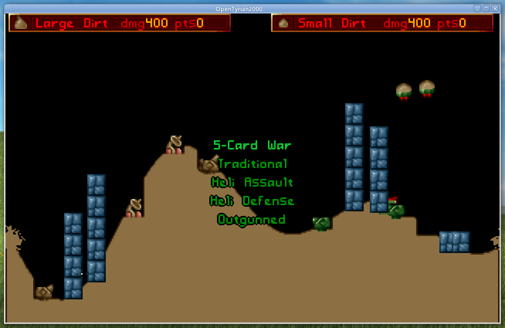

# Destruct

Standalone destruct minigame from Tyrian 2000 (https://tyrian.fandom.com/wiki/Destruct).




## Usage

### Installation
```bash
git clone https://github.com/mm318/destruct.git
```

### Build
All commands should be run from the newly downloaded `destruct` directory.
Use Zig 0.17.1.

SDL 2.32.10 is vendored in `deps/sdl` for Linux and Emscripten, with its Zig
build and a trimmed source distribution.
See [the dependency README](deps/sdl/README.md) for its source, archive
checksum, retained files, and local patches.

On Ubuntu, install the native build dependencies:
```bash
sudo apt install libxext-dev libgles-dev libglx-dev libpulse-dev
```

#### Targeting Native Desktop

To build:
```bash
zig build                   # for debug build
zig build -Doptimize=safe   # for release build
```

For convenience, to run:
```bash
zig build run
```

#### Targeting Web Browser

First install the pinned Emscripten 7.0.0 SDK into `zig-pkg`:
```bash
zig build install-emsdk
```

To build:
```bash
zig build -Doptimize=debug -Dtarget=wasm32-emscripten   # for debug build
zig build -Doptimize=fast -Dtarget=wasm32-emscripten    # for release build (recommended)
```

For convenience, to run:
```bash
zig build -Doptimize=fast -Dtarget=wasm32-emscripten run
```

The web build is installed to `zig-out/web/index.html`. Serve the whole
`zig-out/web` directory over HTTP; pthreads require cross-origin isolation,
provided by the included `coi-serviceworker.js` on localhost or HTTPS.
The browser loop uses `requestAnimationFrame` without Asyncify. Intro, menus,
palette fades, help, and pause screens return control between frames. Gameplay
keeps its original fixed tick rate and presents at most once per display refresh;
hidden tabs do not accumulate simulation time.
Asset extraction runs on the build host and stores generated files in the Zig
build cache.

Builds verified on Ubuntu 26.04 using Zig 0.17.1: native `debug`/`safe` and
web `debug`/`fast` with Emscripten 7.0.0.

Thanks to [sdl-zig-demo-emscripten](https://github.com/silbinarywolf/sdl-zig-demo-emscripten)
and [sokol-zig](https://github.com/floooh/sokol-zig/) for being great references!


### Develop

To format the source code:
```bash
zig fmt .
```
